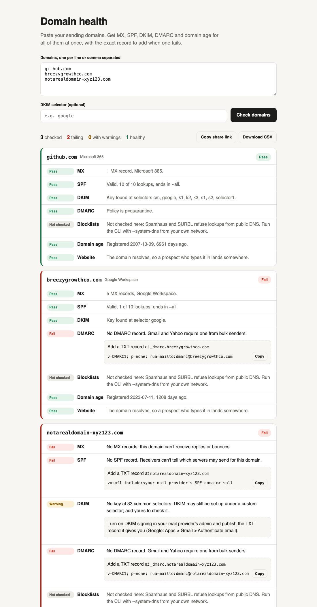

# Domain health

Free health checks for cold email sending domains. Paste every domain at once and get MX, SPF, DKIM, DMARC, domain age and website for each one, with the exact DNS record to add when a check fails.

**Use it in the browser:** https://trav54219.github.io/domain-health/



## What it checks

| Check | Fails when | Warns when |
|---|---|---|
| MX | no MX records, so replies and bounces go nowhere | |
| SPF | no record, more than one record, over the 10-lookup limit (counted through every include), or `+all` | your mail provider (Google, Microsoft, Zoho, Proton, Fastmail) isn't included, `?all`, or no `all` |
| DKIM | | no key at 33 common selectors (a custom selector is still possible, so it's never a fail; enter yours) |
| DMARC | no record, more than one, or no `p=` | `p=none` |
| Domain age | | registered under 30 days ago |
| Website | | the domain doesn't resolve, so a prospect who types it in gets an error |
| Blocklists (CLI only) | listed on Spamhaus DBL or SURBL | a list refused the query |

Every failing check comes with the fix: the TXT record to add, or the change to make.

## Why blocklists aren't in the browser version

Spamhaus and SURBL refuse lookups that come through public resolvers like Cloudflare and Google. They answer with a "refused" code, not "not listed". A browser can only reach DNS through those resolvers, so the web version says "not checked" instead of showing a green tick it can't back up. The CLI with `--system-dns` uses your own resolver. A refused answer is still reported as unknown, never as clean.

## Command line

Needs Node 18 or newer. No dependencies.

```
npx github:Trav54219/domain-health acme.com tryacme.com
npx github:Trav54219/domain-health --file domains.txt --system-dns
npx github:Trav54219/domain-health --file domains.txt --json
npx github:Trav54219/domain-health acme.com --selector s2048
```

It exits with code 1 when any domain fails, so a scheduled job goes red.

## Check every day, alert in Slack

Copy [`examples/daily-domain-check.yml`](examples/daily-domain-check.yml) into `.github/workflows/` in any repo. Add a `domains.txt` and a `SLACK_WEBHOOK_URL` secret, and you get a Slack message whenever a domain fails or warns. GitHub's runners sit on cloud networks that some blocklists refuse, so a blocklist result from Actions may come back unknown. Run it from your own machine for a definite answer.

## How it works

`core.js` holds every check. It takes a `resolve(name, type)` function, so the same code runs in the browser over DNS-over-HTTPS (Cloudflare, with Google as a fallback), in Node, and in the tests with a fake DNS. Domain age comes from the registry's own RDAP server, found through IANA's bootstrap file. Some TLDs, like .io, don't publish RDAP, and for those the age shows as unknown.

Nothing is stored. Each domain you check is sent to the public DNS resolvers and its registry, the same as running `dig` yourself.

```
node --test     # 6 tests
```

## Why I built it

I run cold email infrastructure. When one of our shared domains landed on Spamhaus, 309 sending accounts had to be replaced. This is the check I want running on every domain every morning.

Built by [Travis Heurtelou](https://trav54219.github.io/gtm-engineering-portfolio/). MIT license.
